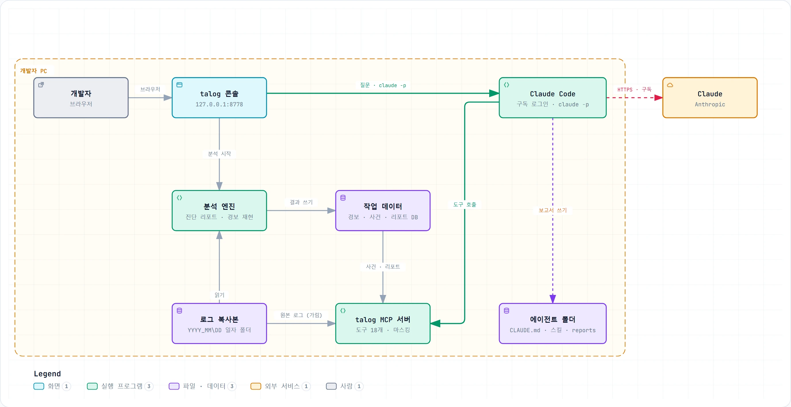
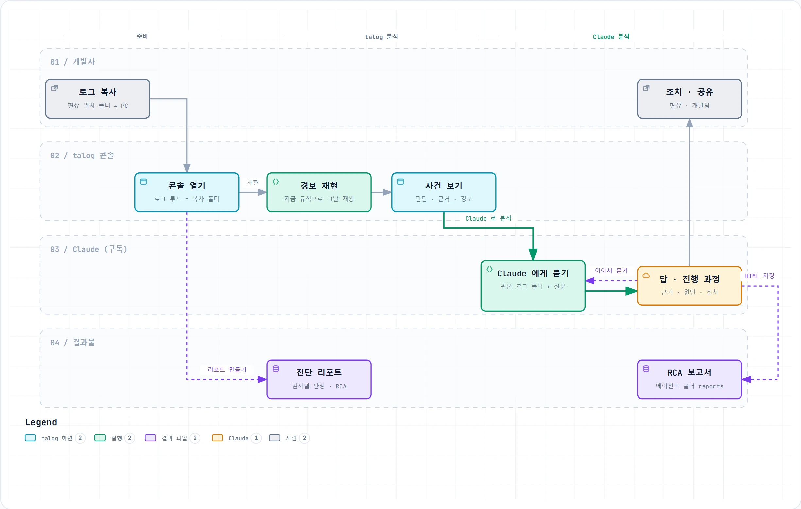
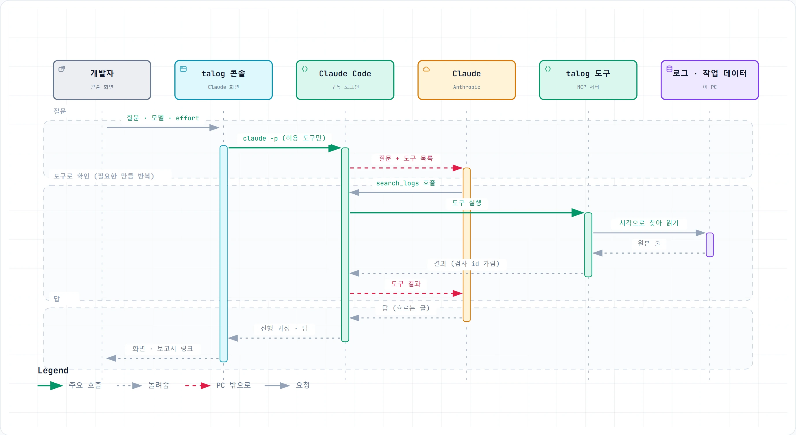

# talog 개발자 PC 매뉴얼

> 저장소 판입니다. 콘솔 화면 캡처는 현장 로그로 찍은 화면이라 뺐습니다(배포판 매뉴얼 HTML 에 들어 있습니다).

현장에서 가져온 로그를 개발자 PC 에서 talog 와 Claude 로 살펴보는 방법입니다.

## 이 매뉴얼의 전제

- 개발자 PC 에 현장 talos 로그가 일자 폴더째 복사돼 있습니다.
- 이 PC 의 Claude 계정(Pro·Max 구독)이 로그인돼 있습니다. 명령 프롬프트에서 `claude` 를 실행했을 때 로그인 화면이 나오지 않으면 됩니다.
- talog 2.3 을 기준으로 씁니다. 운영 현황 맨 위에 '에이전트 브리핑'이 있고 사건 상세에 '처리 과정' 탭이 있으면 2.3 입니다.
- talog 를 **개발자 모드**로 씁니다. 개발자 PC 배포판의 `talog.yaml` 은 이미 `mode: developer` 입니다. 콘솔 왼쪽 위
  모드 전환에서 '개발자'가 골라져 있고 왼쪽 메뉴에 Claude 가 있으면 됩니다. '현장'이나 '운영자'로 열렸다면 왼쪽 위에서
  '개발자'를 누르고 PIN(사내 담당자에게 문의)을 넣습니다. 고른 모드는 다음에 열 때도 그대로입니다.

현장 PC 의 talog 는 현장·운영자 모드로 룰과 로컬 LLM 만 써서 오프라인 감시를 합니다(Claude 메뉴가 없습니다). 이 매뉴얼은 그
현장 로그를 개발자 모드로 사무실에서 다시 볼 때 쓰는 방법만 다룹니다.

## 1. 한눈에 보기



- 로그 복사본, talog, Claude Code 는 모두 개발자 PC 에 있습니다.
- PC 밖으로 나가는 것은 Claude 에게 보내는 질문과, talog 도구가 돌려준 글뿐입니다. 로그 파일을 통째로 보내지 않습니다.
- talog 콘솔은 이 PC(127.0.0.1)에서만 열립니다.



순서는 다섯 단계입니다.

1. 현장 일자 폴더를 PC 로 복사합니다.
2. talog 콘솔을 열고 로그 루트를 복사한 폴더로 맞춥니다.
3. 경보 재현이나 진단 리포트로 그날을 다시 돌려 봅니다.
4. 사건 화면에서 talog 의 판단과 근거를 읽습니다.
5. 더 깊이 볼 사건은 Claude 에게 묻습니다. Claude 는 원본 로그를 직접 찾아 읽고 답합니다.

원인을 확인한 사건은 '해결 기록'으로 마무리해 두십시오(3-5). 다음에 비슷한 사건이 나면 talog 가 그 기록을 함께 보여 줍니다.

## 2. 처음 한 번 준비하기

### 2-1. 로그 복사

현장 PC 의 talos 로그 루트(예: `D:\AIV_LOG\Talos`) 아래에 있는 일자 폴더(`YYYY_MM\DD`)를 통째로 복사합니다. 파일을 골라 담지 마십시오. InspStarter.log, comm.log, seq_N.log, alg 폴더가 같이 있어야 talog 가 검사 하나의 흐름을 이어 봅니다.

개발자 PC 에는 설비마다 루트를 하나 만들고 현장과 같은 모양으로 둡니다.

```
D:\AIV_LOG\설비A\2026_10\11
D:\AIV_LOG\설비A\2026_10\12
```

`D:\AIV_LOG\설비A\12` 처럼 일자 폴더만 두어도 됩니다.

- 사고 전날 폴더도 같이 가져오십시오. 경보 재현이 전날 기동 직후의 처리 여유 기준선을 이어받아 경보를 더 일찍 더 정확하게 냅니다.
- DLInfer.log 처럼 몇 GB 짜리 파일도 지우지 마십시오. talog 는 줄 앞의 시각으로 바로 찾아가기 때문에 파일이 커도 느려지지 않습니다.
- 레시피 폴더(ALG.ini 가 있는 폴더)는 있으면 좋습니다. 진단 리포트가 알고리즘 번호를 결함 이름과 모델로 바꿔 보여 줍니다.

### 2-2. Claude 로그인 확인

- 명령 프롬프트에서 `claude --version` 을 실행해 Claude Code 가 있는지 봅니다.
- `claude` 를 실행했을 때 로그인 화면이 나오면 회사 구독 계정(Pro·Max)으로 로그인하고 `/exit` 로 나옵니다. `/status` 로 지금 로그인한 계정을 볼 수 있습니다.
- Claude 데스크톱 앱의 Code 탭을 써 본 PC 라면, 앱이 받아 둔 Claude Code 를 talog 가 찾아 씁니다.
- 콘솔의 Claude 화면 맨 위에 'Claude Code 2.x' 가 초록색으로 보이면 준비가 끝난 것입니다.
- API 키는 필요 없습니다. 이 PC 에 `ANTHROPIC_API_KEY` 가 설정돼 있어도 talog 는 그 값을 빼고 Claude Code 를 실행합니다. 늘 구독 로그인으로만 돕니다.

### 2-3. talog 실행

- 배포판을 받았다면 talog 폴더의 `run_talog.bat` 을 더블클릭합니다. 검은 창이 뜨고 브라우저에 콘솔(http://127.0.0.1:8778)이 개발자 모드로 열립니다. 검은 창을 닫으면 콘솔도 꺼집니다.
- 소스로 쓴다면 저장소 폴더에서 `pip install -e .` 를 한 번 실행하고 그다음부터는 `talog` 로 엽니다. 처음 한 번 왼쪽 위에서 개발자 모드로 바꾸면(PIN) 그 뒤로는 그대로 열립니다(`talog --mode developer` 는 이번 실행만).
- 설비가 여럿이면 설비마다 설정 파일을 하나씩 만들고 `talog --config D:\talog\설비A.yaml` 처럼 골라 엽니다.
- 다른 talog 가 8778 포트를 쓰고 있다면 `talog --port 8780` 처럼 포트를 바꿉니다.

### 2-4. 설정

콘솔 왼쪽 메뉴의 설정 → 1 수집에서 세 칸을 채웁니다.

| 칸 | 넣을 값 | 예 |
|---|---|---|
| 설비 이름 | 기록·보고서에 쓸 이름 | 설비A |
| talos 로그 루트 | 2-1 에서 만든 설비 루트 | `D:\AIV_LOG\설비A` |
| 저장 폴더 | 경보·사건·진단 리포트·해결 기록·Claude 작업 폴더가 생길 곳 | `D:\talog_data\설비A` |

- 아래쪽 '저장하고 적용'을 누릅니다. 설정은 `talog.yaml` 에 저장되고 이전 파일은 `.bak` 으로 남습니다.
- 설정 맨 위 '모드' 카드에 지금 모드가 '지금'으로 표시됩니다. 개발자 PC 에서는 '개발자 모드'여야 합니다. 설정 저장은 모드를 바꾸지 않습니다 — 모드는 왼쪽 위에서만 바꿉니다.
- 개발자 PC 에는 오늘 날짜 폴더가 없으므로 운영 현황 맨 위에 '오늘 로그 폴더가 아직 없습니다'가 뜹니다. 정상입니다.
- 메일 알림은 꺼 두십시오. 설정 → 4 알림에서 '보내지 않음'을 고릅니다.

## 3. talog 로 그날 보기

### 3-1. 경보 재현

1. 왼쪽 메뉴 분석을 엽니다.
2. '일자 폴더 또는 설비 폴더' 칸에 그날 폴더를 넣습니다. 칸 아래 최근 폴더 칩을 눌러도 됩니다.
3. '경보 재현'을 누릅니다. 지금 규칙으로 그날을 시간순으로 다시 돌려 경보와 사건을 만듭니다. 메일은 보내지 않습니다.
4. 하루치는 로그 양에 따라 몇 분 걸립니다. 진행 기록이 아래에 나오고 그동안 다른 화면을 봐도 됩니다.
5. 끝나면 '사건 화면에서 재현 보기'를 누릅니다.

규칙을 고친 뒤 다시 돌리면 결과가 어떻게 바뀌는지 볼 수 있습니다. 저장하지 않은 규칙 변경은 재현에 들어가지 않습니다.
재현으로 만든 사건에도 해결 기록과 오경보를 남길 수 있고, 규칙마다 오경보가 얼마나 나왔는지는 설정 → 2 탐지에서 봅니다(3-5).

### 3-2. 진단 리포트

- 같은 화면의 '진단 리포트 만들기'는 검사 한 건마다 판정, 끝나지 못한 이유(RCA), 타임라인을 담은 HTML 리포트를 만듭니다. 목록의 '열기'로 봅니다.
- '질문'을 누르면 로컬 LLM 이 리포트 DB 를 SQL 로 조회해 답합니다. 이 PC 에 Ollama 가 있을 때만 됩니다.
- 'Claude 로 확인'은 리포트의 자동 소견을 Claude 가 리포트 DB 로 다시 확인하게 합니다.

### 3-3. 운영 현황에서 그날 모양 보기

- **에이전트 브리핑**: 맨 위 상태 카드 아래에서 talog 가 지난번 확인 뒤 생긴 사건, 오늘 한 일(검사·경보·사건·판단 일치·메일), 가장 빠듯한 그룹의 버틸 여유, 마무리 안 된 사건을 문장으로 정리합니다. 글은 모두 상태 기록으로 만들므로(LLM 을 쓰지 않음) 지어낸 숫자가 없습니다. '지난번 확인' 시각은 이 브라우저가 기억하고, '접기'로 접어 둘 수 있습니다. 개발자 PC 에서는 오늘 읽은 검사가 없으므로 '오늘은 아직 읽은 검사가 없습니다'가 정상입니다.
- **최근 상태 기록**: 날짜마다 24칸이 있고 칸 색은 그 시간에 난 가장 심한 경보입니다. 빨강은 심각, 노랑은 주의입니다. 칸에 마우스를 올리면 경보 수, 검사 수, 거부 수, 최저 내성이 나옵니다. 경보 재현 기록은 '재현' 줄로 따로 나옵니다.
- **처리 여유 추세**: 시간마다 모든 Seq 그룹 가운데 가장 낮은 일시 지연 내성을 선으로 그립니다. 내성은 '한계 − 점유 p99'를 한계에 대한 %로 나타낸 값입니다. 20% 아래 빨간 띠에 들어가면 잠깐만 늦어져도 NoInspThread 가 날 수 있습니다.
- **그룹별 처리 여유**: 그룹마다 점유 p99 와 한계(스레드 수 × 투입 간격)를 막대로 견줍니다. 개발자 PC 에는 실시간 값이 없으므로 가장 최근 기록(경보 재현)의 마지막 시간을 보여 줍니다.

### 3-4. 사건 보기

사건은 가까운 시각의 경보를 묶어 근거와 판단과 조치를 모은 기록입니다.

- 왼쪽 목록은 찾기(제목·원인·사건 id), 심각도 칩, 기간, '재현 포함', '마무리 안 된 것만'으로 거릅니다. 줄마다 상태 칩(새 사건·확인 중·해결·오경보)이 붙습니다.
- 상세 맨 위의 **사건 요약** 네 칸(무슨 일 · 왜 · 지금 할 일 · 판단 확신)을 먼저 읽습니다.
- **판단** 탭: 룰이 고른 원인입니다. 로컬 LLM 의견이 같은 원인을 짚으면 '판단 일치'로 표시합니다. 권고 조치, 담당, 핵심 사실, 그리고 **비슷한 과거 사례**도 여기 있습니다. 과거 사례는 기본 사례 KB 와 이 설비의 해결 기록(3-5)에서 찾고, 룰 진단과 LLM 판단에는 쓰지 않으므로 판단 결과를 바꾸지 않습니다.
- **처리 과정** 탭: talog 에이전트가 이 사건을 처리한 순서입니다. 아래를 보십시오.
- **근거** 탭: 룰 근거와 LLM 2차 의견입니다.
- **경보** 탭: 경보를 시간순으로 보여 주고 근거 로그 줄을 펼쳐 볼 수 있습니다.
- **메일** 탭: 보냈을 메일입니다. 재현 사건이면 보관만 한 메일입니다.
- 상세 오른쪽 위에 버튼이 둘 있습니다. **Claude 로 분석**은 이 사건의 RCA 를 Claude 에게 맡깁니다(사건 RCA 스킬). **원본 로그로 확인**은 그날 로그 폴더를 Claude 가 직접 읽도록 고른 다음, 사건 시각 앞뒤를 조사하게 합니다.

처리 과정은 사건 기록에 남은 값만 보여 줍니다. 새로 계산하거나 지어내지 않습니다.

1. 경보 받음 → 2. 사건으로 묶음 → 3. 근거 모음 → 4. 룰 진단 → 5. 비슷한 과거 사례 → 6. 로컬 AI 2차 의견 → 7. 수치 대조 → 8. 합의 관문 → 9. 알림 → 10. 사람의 확인

- 단계마다 기록된 값(근거 수, 모델·장치·걸린 시간, 근거에 없는 값, 보낸 메일)과 상태(완료 · 확인 필요 · 실패 · 건너뜀)가 나옵니다.
- 판단 탭 아래에도 '에이전트가 이 사건을 N단계로 처리했습니다 — 확인할 단계 k개'가 한 줄로 나옵니다. 확인할 단계가 있으면 처리 과정에서 그 단계부터 보십시오.
- '수치 대조'는 로컬 AI 문구의 숫자와 시각이 근거에 실제로 있는지 talog 가 맞춰 본 결과입니다. 근거에 없는 값이 있으면 메일에는 룰 문구를 씁니다. 조치 문장을 런북 문장으로 바꾼 경우도 여기에 나옵니다.

### 3-5. 사건 마무리 — 해결 기록과 오경보

사건을 다 봤으면 상세 맨 위 **사건 상태** 줄에서 마무리합니다. 모드와 상관없이(현장 모드에서도) 할 수 있습니다.

- **확인**: 보고 있다는 표시입니다. 상태가 '확인 중'이 됩니다.
- **해결 기록**: 실제 원인과 한 조치를 남깁니다(메모는 선택). 칸에는 talog 가 고른 원인과 첫 권고 조치가 미리 들어 있으니 실제와 다르면 고쳐 씁니다. **사례로 저장**을 켜 두면(기본) 이 설비의 사례 KB(저장 폴더 `kb\`)에 들어가, 다음에 비슷한 사건이 나면 판단 탭·메일의 '비슷한 과거 사례'와 Claude 의 사례 찾기(`search_cases`)에 함께 나옵니다.
- **오경보**: 경보가 실제 문제가 아니었다는 표시입니다. 설정 → 2 탐지의 규칙마다 최근 7일 경보 수와 그중 오경보 사건의 경보 수가 나오고(실시간과 재현은 따로), 오경보가 절반을 넘는 규칙(2건 이상)에는 조건을 높이거나 등급을 낮추라는 권고가 붙습니다. 규칙은 저절로 바뀌지 않습니다.
- 잘못 고른 상태는 **다시 열기**로 되돌립니다.
- 기록은 저장 폴더의 `incident_notes.jsonl` 에 남습니다. 해결 기록과 사례 KB 는 이 PC 의 저장 폴더에만 남고 현장 PC 와는 따로입니다.

## 4. Claude 에게 묻기

### 4-1. 화면 구성

- **위**: Claude Code 버전, 로그인 상태, 구독 사용량.
- **가운데**: 대화입니다. 내 질문은 주황 말풍선으로, Claude 의 답은 그 아래에 나옵니다. 답 위의 '확인한 과정'에는 Claude 가 무엇을 확인했는지가 차례로 남습니다.
- **아래**: 입력창입니다. 맥락 칩(이어서 묻기, 원본 로그 폴더), 모델, effort, 보내기와 멈추기가 있습니다.
- **오른쪽**: 작업 스킬 카드(대화가 있을 때), 분석할 원본 로그, 데이터·비용 원칙. talog 도구 목록은 '연결 설정' 4번에 있습니다.
- 빈 대화에서는 가운데에 **작업 스킬 카드 5개**가 보입니다 — 사건 RCA · 원본 로그 조사 · 하루 검토 · 현장 점검·규칙 조정 ·
  규칙 바꾼 뒤 비교. 카드마다 무엇을 남기고 얼마나 걸리는지 적혀 있습니다.

### 4-2. 원본 로그 폴더 고르기

- 오른쪽 '분석할 원본 로그' 칸에 일자 폴더 경로를 넣고 '고르기'를 누릅니다. 칸을 누르면 설정의 로그 루트 아래 일자 폴더가 목록으로 나옵니다. 다른 곳에 복사해 둔 폴더도 고를 수 있습니다.
- InspStarter.log, comm.log, alg 가 들어 있는 일자 폴더나 그 상위 폴더만 받습니다.
- 고르면 입력창에 '원본 로그 …' 칩이 붙습니다. 질문할 때 Claude 는 그 폴더를 '선택'이라는 이름으로만 압니다. 실제 경로는 보내지 않습니다.
- 사건 화면의 '원본 로그로 확인'과 분석 화면의 'Claude 로 원본 로그 조사'는 폴더 고르기와 질문을 한 번에 합니다.

### 4-3. 질문 쓰는 법

좋은 질문에는 시각, 증상, 범위가 들어 있습니다.

| 하고 싶은 것 | 질문 예 |
|---|---|
| 거부 원인 찾기 | 12일 05:02 NoInspThread 전후 5분 원본 로그를 보고 원인을 정리해 줘 |
| 검사 한 건 추적 | 검사 ID-3f2a91 이 어느 단계에서 늦어졌는지 추적해 줘 |
| 추세 보기 | 그룹 10 의 점유 시간이 언제부터 늘었는지 시간별 표로 보여 줘 |
| 하루 검토 | 12일 경보와 사건을 훑고 놓친 징후나 오경보가 있는지 봐 줘 |
| 보고서 남기기 | 사건 20261012-050228-capacity_drift 를 RCA 보고서로 남겨 줘 |

- 범위가 넓을수록 오래 걸리고 사용량도 많이 듭니다. `05:00~05:05` 처럼 시각 범위를 주십시오.
- 작업 스킬 카드를 누르면 필요한 값(사건·일자 폴더·시각·증상·날짜)만 묻고, 그 작업의 절차(스킬)로 새 대화를 엽니다.
  Claude 앱에서 `/talog-rca <사건 id>` 처럼 부르는 것과 같습니다(부록 B).
- **규칙 바꾼 뒤 비교** 카드의 '그날 로그를 지금 규칙으로 재현'을 켜면 한 번 더 확인을 받은 뒤, 그 질문에서만 Claude 가
  재현 도구(파일을 씀)를 쓸 수 있습니다.
- 답 아래 **수치 근거** 배지는 답에 적힌 숫자·시각이 Claude 가 읽은 talog 도구 결과에 실제로 있는지 talog 가 대조한 결과입니다.
  '도구 결과에 없는 값'이 있으면 보고서에서 그 값을 확인하십시오.
- 화면의 어려운 말 옆 (?) 를 누르면 뜻이 나오고, 위 막대 오른쪽 (?) 버튼(또는 ? 키)은 이 화면 읽는 법과 용어 사전을 엽니다.

### 4-4. 모델과 effort 고르기

| 상황 | 모델 | effort |
|---|---|---|
| 짧게 확인할 때 | Sonnet | 낮음 |
| 사건 하나의 원인 분석 | Sonnet 또는 기본 | 보통 |
| 여러 날·여러 그룹을 엮는 깊은 RCA | Opus | 높음 이상 |
| 구독 사용량이 거의 찼을 때 | Sonnet 또는 Haiku | 낮음 |

- effort 는 생각하는 깊이입니다. 높이면 더 깊이 보지만 오래 걸리고 사용량이 늘어납니다.
- '기본'은 구독 계정에 설정된 값을 씁니다. 고른 값은 이 브라우저에 기억됩니다.

### 4-5. '확인한 과정' 읽기 — talog 도구



talog 도구는 Claude 가 답을 찾으면서 스스로 부르는 talog 기능입니다. 사람이 누르는 버튼이 아닙니다. 도구는 이 PC 에 있는 로그, 사건, 리포트를 읽어 글로 돌려주고 Claude 는 그 글을 보고 다음에 무엇을 볼지 정합니다.

- '확인한 과정'에는 도구 이름, 대상, 걸린 시간이 차례로 나옵니다.
- '▸ talog 가 돌려준 결과'를 펼치면 Claude 가 받은 글을 그대로 볼 수 있습니다. 검사 id 는 ID-xxxxxx 로 가려져 있습니다.
- 말풍선 아이콘이 붙은 줄은 Claude 가 도구를 부르기 전에 남긴 메모입니다.

예를 들어 "05:02 무렵 NoInspThread 를 찾고 직전 흐름을 정리해 줘"라고 물으면 이렇게 진행됩니다.

1. 원본 로그 찾기: 'NoInspThread', 05:00~05:05 범위 (0.4초, 3건)
2. 원본 로그 읽기: comm.log 05:02:49 앞뒤
3. 원본 로그 읽기: comm.log 05:01:50 앞뒤
4. 답: 어느 제품이 거부됐고 직전 1분 동안 무슨 일이 있었는지

도구 18개 전체는 부록 A 에 있습니다.

### 4-6. 이어서 묻기, 새 대화, 멈추기

- 답이 끝난 뒤 다시 보내면 Claude 가 앞 대화를 기억한 채로 답합니다. 입력창에 '이어서 묻기' 칩이 붙어 있을 때입니다. 앞에서 찾은 내용을 다시 찾지 않으므로 빨리, 적은 사용량으로 끝납니다.
- 주제가 바뀌면 '새 대화'로 시작하십시오. 사건마다 새 대화를 여는 편이 좋습니다.
- '멈추기'는 진행 중인 Claude 를 끝냅니다. 그때까지 쓴 보고서 파일은 남습니다.
- '다시 묻기'는 같은 질문을 다시 보냅니다.
- 콘솔 화면을 새로 고쳐도 대화는 남습니다. 콘솔(검은 창)을 끄면 사라집니다.
- 질문 하나는 최대 60단계, 20분까지 돕니다. 넘으면 끊기므로 질문을 좁혀 다시 보내십시오.

### 4-7. 결과 보기

- 답은 화면에 바로 나옵니다.
- 보고서를 만들어 달라고 하면 저장 폴더의 `claude_agent\reports\` 아래에 HTML 이 생기고 답 아래에 '보고서' 링크가 붙습니다.
- 답 아래에는 'AI 가 만든 답 — 근거를 확인하십시오'가 붙어 있습니다. 답에 나온 숫자와 시각이 '확인한 과정'의 도구 결과에 있는지 꼭 대조하십시오.
- Claude 와 함께 원인을 확정했다면 사건 화면에서 해결 기록으로 남기십시오(3-5). 다음 비슷한 사건에 그 기록이 붙습니다.

### 4-8. 구독 사용량

- 화면 위쪽에 '구독 사용량 7일 92% · 10/15 09:00 초기화'처럼, 질문할 때 Claude Code 가 알려 준 사용률이 나옵니다. 90% 를 넘으면 빨간색으로 바뀝니다.
- 사용량은 이 PC 의 다른 Claude 대화와 합쳐서 셉니다.
- 한도에 닿으면 초기화 시각까지 멈춥니다. 구독의 추가 사용량(초과 결제)을 꺼 두면 돈이 더 나가지 않고 그냥 멈춥니다.

## 5. Claude 앱에서 쓰기 (선택)

콘솔 대신 Claude 데스크톱 앱(Code 탭)이나 명령 프롬프트의 Claude Code 에서 talog 를 쓸 수도 있습니다. 긴 RCA 를 Claude 와 여러 번 주고받을 때 편합니다.

1. 콘솔 Claude 화면에서 '연결 설정' → '폴더 만들기'를 누릅니다. 저장 폴더 아래 `claude_agent` 가 에이전트 폴더가 됩니다.
2. Claude 데스크톱 Code 탭에서 그 폴더를 열거나, 명령 프롬프트에서 그 폴더로 이동해 `claude` 를 실행합니다.
3. `/talog-rca 20261012-050228-capacity_drift`, `/talog-logs 12 05:02 NoInspThread` 처럼 작업 스킬을 부르거나, "talog 사건 …
   분석해 줘"처럼 말합니다(맞는 스킬을 Claude 가 스스로 불러옵니다 — 재현이 든 `/talog-rules` 는 직접 부를 때만).
   Claude 데스크톱 채팅처럼 스킬이 없는 곳에서는 `/mcp__talog__incident_rca` 같은 talog 프롬프트를 고릅니다.

- 에이전트 폴더의 `CLAUDE.md` 에는 Claude 의 일하는 방식(계획 먼저, 근거로만 말하기, 배운 점)이 들어 있습니다. 보고서가 틀렸다면 '배운 점'에 한 줄 더하십시오. 다음 분석부터 반영됩니다.
- 다른 폴더에서도 talog 도구를 쓰려면 '연결 설정'에 나온 'Claude Code 에 연결' 명령을 명령 프롬프트에서 한 번 실행합니다.
- '연결 시험'은 Claude 가 띄울 명령 그대로 talog 를 띄워 점검합니다. `talog mcp --self-test` 와 같습니다.
- 앱에서는 콘솔이 기본으로 막아 둔 두 도구(경보 재현 시작, 사례 저장)도 씁니다. 파일을 쓰는 도구라서 앱이 실행 전에 확인을 받습니다.
  콘솔에서는 '규칙 바꾼 뒤 비교' 카드에서 확인했을 때만 재현을 엽니다.

## 6. 데이터와 비용 원칙

- **추가 과금 없음**: 구독 로그인으로만 실행합니다. API 키와 게이트웨이 설정은 빼고 띄웁니다. 사용량은 구독 한도에서 빠집니다.
- **나가는 것**: 질문, 그리고 talog 도구가 돌려준 글입니다. 검사 id 는 ID-xxxxxx 로, 경로는 `<로그>` 로 가립니다. Claude 가 ID-xxxxxx 로 다시 찾으면 talog 가 이 PC 의 대응표로 원래 값을 찾아 씁니다.
- **그래도 Anthropic 으로 전송됩니다**: 고객이 허락한 범위의 로그만 다루십시오. 개인 요금제라면 개인정보 설정의 '모델 개선에 대화 사용'을 끄십시오.
- **쓰기 범위**: talog 도구는 읽기만 합니다. 콘솔에서 물을 때 Claude 가 쓸 수 있는 곳은 에이전트 폴더의 reports 하나뿐이고 명령 실행과 설정 파일 수정은 막혀 있습니다.
- **결과물**: 이 PC 의 HTML 로만 남깁니다. claude.ai 같은 외부 서비스에 올리지 않습니다.

## 7. 문제 해결

| 증상 | 확인할 것 |
|---|---|
| 'Claude Code 없음 — 질문 복사만' | Claude Code 가 없습니다. 설치하거나 Claude 데스크톱 Code 탭을 한 번 열어 두십시오. 그 전에는 '질문 복사'로 질문을 복사해 Claude 앱에 붙여 넣습니다. |
| '로그인되어 있지 않습니다' | 명령 프롬프트에서 `claude` 를 실행해 구독 계정으로 로그인하고 다시 보냅니다. |
| '구독 로그인 확인됨' 대신 'API 과금 계정' 배지 | Claude Code 가 API 계정으로 로그인돼 있습니다. `claude` 에서 `/logout` 한 뒤 구독 계정으로 다시 로그인합니다. |
| 'talos 로그 폴더가 아닙니다' | InspStarter.log, comm.log, alg 가 있는 일자 폴더나 그 상위 폴더를 골랐는지 봅니다. |
| 사건에 '원본 로그로 확인' 버튼이 없음 | 설정의 로그 루트 아래에 그 날짜 폴더가 없습니다. 로그 루트를 확인하거나 Claude 화면에서 폴더를 직접 고릅니다. |
| 답이 오래 걸리거나 20분에서 끊김 | 시각 범위를 좁히고 모델은 Sonnet, effort 는 낮음으로 바꿉니다. |
| 사용량 한도에 닿음 | 초기화 시각까지 기다립니다. 확인용 질문은 Sonnet, 낮음으로 합니다. |
| 경보 재현 결과 사건이 0건 | 폴더에 InspStarter.log 와 comm.log 가 있는지, 설정 → 2 탐지에서 규칙이 꺼져 있지 않은지 봅니다. |
| 콘솔이 열리지 않음 | 다른 talog 가 8778 포트를 쓰는지 봅니다. `talog --port 8780` 으로 엽니다. |
| '오늘 로그 폴더가 아직 없습니다' | 개발자 PC 에서는 정상입니다. |
| 왼쪽 메뉴에 Claude 가 없음 · 'Claude 연동은 개발자 모드에서만 씁니다' | 현장·운영자 모드입니다. 왼쪽 위에서 '개발자'를 누르고 PIN 을 넣습니다. |
| 설정이 회색으로 잠겨 있음 | 현장 모드입니다(현장 PC 의 `talog.yaml` 을 그대로 가져온 경우). 왼쪽 위에서 운영자나 개발자 모드로 바꿉니다. |
| 사건 상태 줄에 '다시 열기'만 있음 | 이미 해결이나 오경보로 마무리한 사건입니다. 다시 열면 확인·해결 기록·오경보를 다시 고를 수 있습니다. |
| 해결 기록을 남겼는데 다른 PC 에서 과거 사례로 안 나옴 | 해결 기록과 사례 KB 는 그 PC 저장 폴더의 `kb\` 에만 있습니다. 다른 PC 에서도 쓰려면 사례 KB 폴더를 함께 옮깁니다. |

## 부록 A. talog 도구 18개

| 도구 | 하는 일 | 콘솔에서 |
|---|---|---|
| `log_days` | 읽을 수 있는 원본 로그 일자 폴더와 날짜·파일 수·크기 | 씀 |
| `log_files` | 일자 폴더의 로그 파일, 분류, 크기, 첫·마지막 시각 | 씀 |
| `read_log` | 파일 하나를 시각 앞뒤로 원문 그대로 읽음 (한 번 최대 300줄) | 씀 |
| `search_logs` | 문구나 정규식을 시각 범위 안에서 찾아 시간순으로 (최대 300건·20초) | 씀 |
| `trace_inspection` | 검사 id 하나를 도착부터 판정·결과 송신·거부까지 시간순으로 모음 | 씀 |
| `overview` | 연결된 데이터의 사건 수, 날짜, 기준선, 리포트 | 씀 |
| `list_incidents` | 사건 목록 | 씀 |
| `get_incident` | 사건 하나의 판단, 근거, 경보, 비슷한 과거 사례 | 씀 |
| `capacity_trend` | Seq 그룹별 기준선과 시간별 처리 여유 | 씀 |
| `rediagnose` | 저장된 사건을 지금 규칙으로 다시 판단해 원인이 바뀌는 사건을 보여 줌 | 씀 |
| `runbook` | 원인과 조치, 담당, 판정 문턱값 사전 | 씀 |
| `search_cases` | 비슷한 과거 사례 찾기 (기본 사례 KB + 이 설비의 해결 기록) | 씀 |
| `list_reports` | 진단 리포트 목록 | 씀 |
| `get_report` | 리포트 하나의 자동 소견과 DB 표 구성 | 씀 |
| `query_report` | 리포트 DB 를 읽기 전용 SQL 로 조회 | 씀 |
| `job_status` | 경보 재현 작업의 진행과 결과 | 씀 |
| `start_replay` | 하루치 로그를 지금 규칙으로 재생 (작업 폴더에 씀) | 앱에서, 콘솔은 비교 카드에서 확인 후 |
| `save_case` | 확정된 RCA 를 사례로 저장 | 앱에서만 |

## 부록 B. 작업 스킬과 talog 프롬프트

| 콘솔 스킬 카드 | Claude Code 스킬 (에이전트 폴더) | Claude 데스크톱 채팅 프롬프트 | 하는 일 |
|---|---|---|---|
| 사건 RCA | `/talog-rca <사건 id>` | `/mcp__talog__incident_rca` | 사건 하나를 근거 확인 → 원인 판단 → 권고 → 보고서까지 |
| 원본 로그 조사 | `/talog-logs <일자> <시각> <증상>` | `/mcp__talog__log_investigation` | 고른 로그 폴더를 직접 읽어 증상의 경과와 원인을 찾음 |
| 하루 검토 | `/talog-daily <날짜>` | `/mcp__talog__daily_review` | 하루치 경보·사건·처리 여유를 훑고 놓친 징후와 오경보를 짚음 |
| 현장 점검·규칙 조정 | `/talog-site <출처>` | `/mcp__talog__site_health` | 기준선·재시작·경보 경향을 보고 문턱값 조정안을 냄 (설정은 바꾸지 않음) |
| 규칙 바꾼 뒤 비교 | `/talog-rules <출처> <일자> [재현 허용]` | `/mcp__talog__rules_compare` | 재진단, (허락하면) 재현으로 전후 비교 |

빈 대화의 '가벼운 질문'(처리 여유 추세 · 리포트 교차 확인)은 스킬 없이 바로 묻는 콘솔 전용 질문입니다.

## 부록 C. 파일 위치

| 무엇 | 어디 |
|---|---|
| 설정 | `talog.yaml` (`run_talog.bat` 옆, 또는 `--config` 로 준 파일) |
| 경보·사건·시간별 기록 | 저장 폴더의 `alerts_*.jsonl`, `incidents_*.jsonl`, `kpi_*.jsonl` (경보 재현은 이름 끝에 `_replay`) |
| 사건 마무리 기록 (확인·해결 기록·오경보) | 저장 폴더 `incident_notes.jsonl` |
| 이 설비의 사례 KB (해결 기록 중 '사례로 저장') | 저장 폴더 `\kb\` |
| 진단 리포트 | 저장 폴더 `\reports\` |
| Claude 에이전트 폴더 | 저장 폴더 `\claude_agent\` (`CLAUDE.md`, `.mcp.json`, `.claude\skills\talog-*` 스킬 5개, `reports`) |
| Claude 보고서 | 저장 폴더 `\claude_agent\reports\` |
| 고른 원본 로그 폴더 기록 | 저장 폴더 `\claude_agent\mcp_jobs\log_roots.json` |
| 검사 id 가림 대응표 | 저장 폴더 `\claude_agent\mcp_jobs\.mask_map.json` (이 PC 밖으로 보내지 마십시오) |
